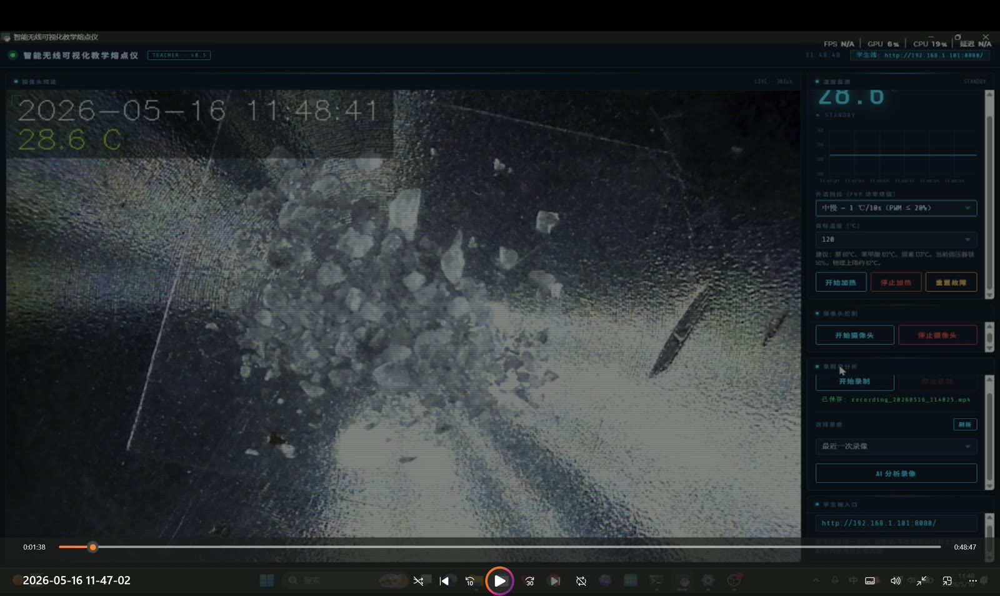

# View+｜数智互动无线可视化熔点测定平台

融合智能仪器、嵌入式温控、计算机视觉与大模型分析的个人软硬件一体化项目。

> This repository is a sanitized public case study. The complete source code, patent materials and raw experimental data remain private.

## 项目概览

View+ 将实验画面、实时温度、加热控制、录像回放和 AI 分析统一到一套工作流中。系统由 Windows 操作端、局域网浏览器用户端和 ESP32-S3 温控固件共同组成。

- Python / Flask / pywebview 桌面与 Web 协同
- ESP32-S3 + MAX31865 + PT100 + SSR 温控链路
- PID、慢 PWM、看门狗、故障锁存与断线降级
- OpenCV 结构化视觉特征与 LLM 推理
- 录像、温度 CSV、回放和 Markdown 报告闭环
- Windows 安装器、凭据保护与可验证交付

## 项目证据

| 项目 | 结果 |
|---|---|
| 开发历史 | 80 次可追溯 Git 提交（完整历史保存在私有仓库） |
| 交互端 | 操作端、浏览器用户端、ESP32-S3 固件 |
| 视觉分析 | 6 类本地视觉特征 + 结构化 LLM 推理 |
| 工程交付 | 测试、部署文档、用户手册和 Windows 安装器 |

## 技术栈

`Python` · `Flask` · `OpenCV` · `pywebview` · `WebSocket` · `ESP32-S3` · `PlatformIO` · `PID` · `Chart.js` · `Nuitka`

## 在线展示

访问完整的响应式项目展示页：

**https://yelan984-ai.github.io/viewplus-showcase/**

## Source policy

本仓库仅公开经过脱敏的项目介绍、界面截图、架构材料和静态展示页，不提供完整项目源代码，也不授予复制、修改、分发或商业使用权限。如需代码审阅或运行演示，可在沟通后按需提供临时访问。

Copyright © 2026. All rights reserved.

